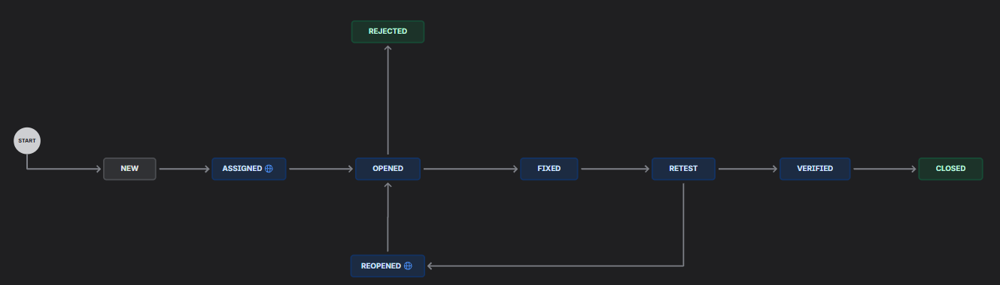

# Naloga 6 – Upravljanje napak (HealthTrackMe-ZK)

## 1. Namen naloge

Za upravljanje napak smo uporabili **Atlassian Jira Cloud**.

## 2. Konfiguracija upravljanja napak

V Jiri smo ustvarili projekt HealthTrackMe-ZK in posebno vrsto opravila **Bug**, namenjeno evidentiranju funkcionalnih napak.

### 2.1 Klasifikacija napak

Ustvarili smo polje `Bug Classification` tipa _Dropdown_, ki omogoča razvrščanje napak v tri kategorije.

| Klasifikacija | Pomen                                                               |
| ------------- | ------------------------------------------------------------------- |
| Bug           | Funkcionalna napaka – aplikacija ne deluje skladno s pričakovanji.  |
| Deficiency    | Pomanjkljivost – manjkajoča ali neustrezno izvedena funkcionalnost. |
| Inconsistency | Nedoslednost – neenotno obnašanje ali prikaz aplikacije.            |

### 2.2 Stopnje kritičnosti

Ustvarili smo polje `Severity`, ki vsebuje štiri stopnje kritičnosti.

| Stopnja | Kritičnost   | Opis                                                                         |
| ------- | ------------ | ---------------------------------------------------------------------------- |
| 4       | Minor        | Manjša napaka, ki bistveno ne vpliva na delovanje aplikacije.                |
| 3       | Major        | Večja napaka, ki ovira določeno funkcionalnost.                              |
| 2       | Critical     | Zelo resna napaka, ki močno vpliva na delovanje aplikacije.                  |
| 1       | Show-stopper | Napaka, ki preprečuje uporabo ključne funkcionalnosti ali nadaljevanje dela. |

### 2.3 Dodatna polja

Za vsako prijavljeno napako smo omogočili beleženje naslednjih podatkov:

| Polje              | Namen                                                          |
| ------------------ | -------------------------------------------------------------- |
| Summary            | Naslov napake                                                  |
| Description        | Opis, koraki za reprodukcijo, pričakovani in dejanski rezultat |
| Bug Classification | Klasifikacija napake                                           |
| Severity           | Stopnja kritičnosti                                            |
| Priority           | Prioriteta odprave                                             |
| Status             | Trenutno stanje napake                                         |
| App Version        | Verzija aplikacije                                             |
| Browser            | Brskalnik, v katerem se napaka pojavi                          |
| Test Case ID       | Identifikator funkcionalnega testa                             |
| Assignee           | Oseba, odgovorna za odpravo                                    |
| Comments           | Komentarji o obravnavi in odpravi napake                       |

## 3. Življenjski cikel napake

_Slika 1: Življenjski cikel funkcionalne napake, konfiguriran v Atlassian Jiri._

## 4. Funkcionalni testi

Pri nalogi smo uporabili šest funkcionalnih testnih primerov iz predhodnih nalog.

| Testni primer | Opis                                               | Zadnji znani rezultat |
| ------------- | -------------------------------------------------- | --------------------- |
| FS-01-TP01    | Registracija, odjava in ponovna prijava uporabnika | PASS                  |
| FS-01-TP02    | Zavrnitev prijave z napačnim geslom                | PASS                  |
| FS-02-TP01    | Dodajanje zdravila in beleženje zaužitega odmerka  | PASS                  |
| FS-02-TP02    | Zavrnitev zdravila brez imena                      | PASS                  |
| FS-03-TP01    | Pošiljanje in sprejem prošnje za prijateljstvo     | PASS                  |
| FS-03-TP02    | Zavrnitev prošnje za prijateljstvo samemu sebi     | PASS                  |

## 5. Evidentirana funkcionalna napaka

Pri 5. nalogi smo namenoma povzročili napako, da bi preverili učinkovitost avtomatiziranega funkcionalnega testiranja.

Napaka je bila uspešno zaznana, odpravljena in ponovno testirana.

Pri 6. nalogi smo to napako evidentirali in upravljali v Jiri.

### 5.1 Podatki o napaki KAN-4

| Lastnost           | Vrednost                                  |
| ------------------ | ----------------------------------------- |
| Jira ID            | KAN-4                                     |
| Summary            | Incorrect medication dose status recorded |
| Bug Classification | Bug                                       |
| Severity           | Major                                     |
| Priority           | High                                      |
| App Version        | 1.1.0+2                                   |
| Browser            | Google Chrome                             |
| Test Case ID       | FS-02-TP01                                |
| Status             | CLOSED                                    |
| Assignee           | Določen v Jiri                            |

### 5.4 Upravljanje napake v Jiri

Napako KAN-4 smo premaknili skozi naslednja stanja:

`NEW → ASSIGNED → OPENED → FIXED → RETEST → VERIFIED → CLOSED`
